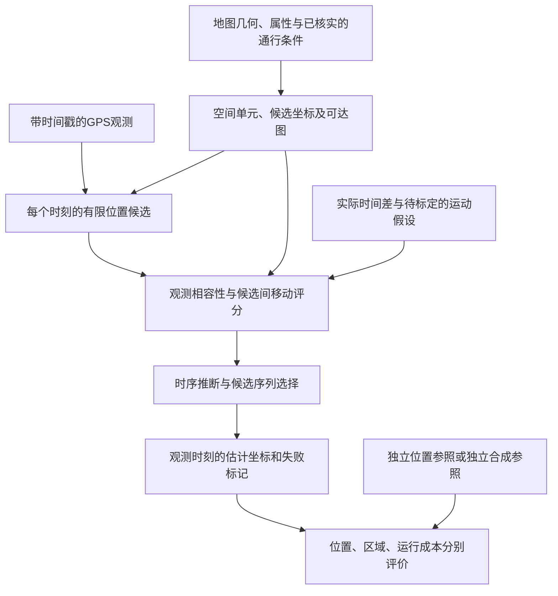

# 从四篇文献到定位纠正：一个越野场景

创建于2026年11月4日。学生已完成四篇核心文献的第一轮项目相关重点阅读，并整理了[阅读笔记](02_阅读笔记.md)。本文是下一次综合辅导的入口；下面的场景、数字和建模选择都是教学设定，不是论文实验、真实丰台通行属性或已经确认的论文方案。本节仍待学生复述与讨论，不把文档创建记为综合理解或方案验证完成。

## 先把任务说清楚

设想运动员沿小径前进，进入可以离路通行的林地，绕过一片水体，再回到小径。我们有带时间戳的GPS读数和地图，希望估计各观测时刻的位置。地图中的水体在这个例子里被明确假设为不可穿越；真实地图中仍需核实是否可涉水、是否有桥和地图是否对齐，不能仅凭“水体”图层名采用这个假设。

这里的任务是推断运动员已经走过的轨迹。最短或最低成本路线只能提供一种移动先验，运动员可能因找点、选线、停留和失误而偏离它；规划出来的路线不能充当实际轨迹的答案。

## 四篇分别提供了什么

Newson把“每点附近有哪些道路可选”与“前后候选怎样移动”放进同一时序推断中。借鉴到本例时，观测噪声、候选评价和整段选择仍有用，但候选空间需要覆盖合法离路运动。

Behr扩展了可计算的空间：对开放多边形剖分，把剖分边接入道路图，在图边上生成位置候选。三角形在这里组织几何与连接，不自动成为HMM状态。若本课题改用区域编号作状态，还要另行定义区域内的候选坐标或坐标估计方法。

Ma提醒我们把两件事分开：知道“此刻在开放区”与恢复该处坐标。其开放区候选本身仍取GPS读数，轨迹恢复另接Y-net，并有后续观测条件。因此，增加区域状态以后，仍要回答坐标从何而来以及用了哪些时刻的信息。

Albert展示了地形和地表覆盖如何成为数值运动代价。把这种代价用于定位时，需要重新定义它与时间、速度、转移评分的关系。经过归一化和经验融合的代价不能直接当作米制距离，不能原样替换Newson公式中的道路距离，也不自动成为经过标定的概率。

这些对应关系属于本课题的解释与方案设计，不表示四篇已经共同验证了同一套越野定位算法。各论文事实和原文定位见[阅读笔记](02_阅读笔记.md)与[核心对照](01_核心文献对照与研究问题.md)。

## 从地图到候选，再到坐标

可以把最小数据流画成下面这样。它表达职责关系，尚未固定最终采用均匀网格、三角剖分还是其他空间表示。

空间单元是组织地图的容器，候选是算法当时允许选择的假设，坐标是最终需要评价的数值。三者可以有不同的对应关系。即使知道一个人位于某片林地，也还存在许多可能位置；若统一输出单元中心，便引入了离散化误差，单元较大时这个误差可能更明显。

## 一个只需要算距离的小例子

现在只看前一时刻的一个位置假设R，以及10秒后的两个候选P、Q。教学设定中，当前GPS距P为6米、距Q为2米；地图图上从R到P的最短可行路径长20米，从R到Q要绕过障碍，最短可行路径长80米。这里的图距离是人为给定的例子条件，不是从现有地图测得。

仅按当前观测距离，Q更受支持。若再假设这10秒内速度不超过3米/秒，允许移动的路径长度就不超过30米：到P所需平均速度是2米/秒，到Q是8米/秒。于是，在地图、R位置与速度上限均成立的条件下，R到Q这次转移会被排除，R到P仍可参与选择。

这不是证明真实位置一定是P。R也可能只是众多前序候选之一；完整推断应同时保留其他前序假设。若地图漏了一座桥、速度上限不适用，或者真实位置没有进入候选集，原来的排除也可能错误。对不确定的地图信息宜保留未知与退化处理，对软运动偏好应定义可检验的评分，而不是一律硬排除。

现在可以分别问：GPS为什么支持Q？地图和时间为什么让R到Q受到限制？如果输出的只是“人在林地”，这道选择题是否已经解决？这三问对应观测模型、转移模型和坐标输出，下一轮先用自己的话解释它们。

## 与已有原型接上

现有v0.1已经有均匀格网中心候选、图距离查询、运动评分、离线Viterbi和逐时刻坐标输出。它采用非归一化转移势，是HMM风格基线；本文没有新增实现、改变参数或完成自适应剖分。当前实现与证据见[原型数据流](../实验原型/docs/实验设计与数据流.md)及[接力说明](../研究进度与接力说明.md)。

地图若是一大片同质林地，没有可靠边界、地标或其他辨识信息，许多平移后的轨迹可能同样符合地图与移动约束。此时更平滑并不保证更准确。空间表示能提供的定位信息有边界，需要用失败案例检验。

工程上的下一项仍是固定v0.1，增加相近候选预算下的无地图运动对照，分离运动先验、地图和格网量化的影响；再在相同地图信息、推断设置与可比计算预算下比较空间划分。实测结论还需要真实GPS与质量明确的独立参照。阅读和本例讲解不改变这些待完成状态。

后续按问题查阅ISOM的通行语义与制图误差、LaValle的单元连通与孔洞，以及需要的运动模型资料。是否研究在线处理、三维体剖分或AR/定姿，仍由导师确认；本节先把位置推断的数据流和输出定义说明白。
