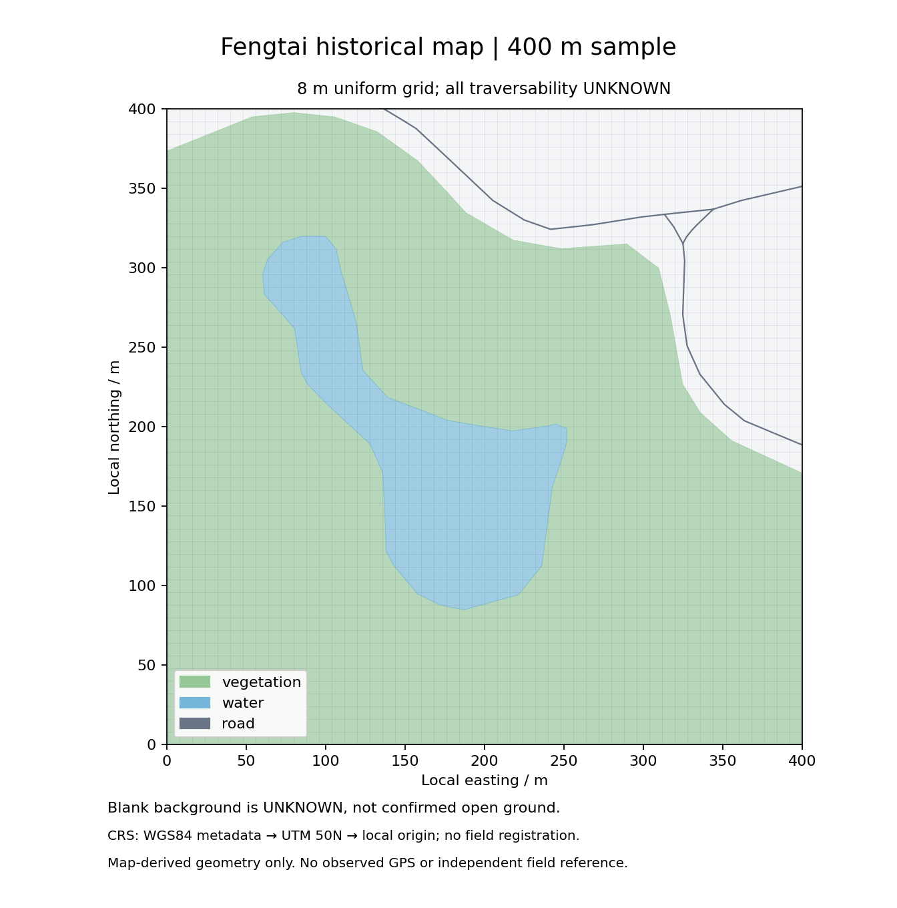

# 地图模块、丰台样区与近似边界

本版把地图处理成一个可以查询候选坐标和候选之间空间距离的均匀格网图。它是第一版可复现实验的基线，不是已经验证优于其他方法的剖分方法。合成地图中明确设定的障碍可产生硬约束；丰台历史地图只提供几何和原编码，所有通行性仍为 `unknown`。这两种证据不能混用。

## 丰台样区从哪里来

`prepare_map.py` 只读已有 `数据核查/2026-11-01/可用地图/丰台基础地图.gpkg`，读取道路、植被、水系和政区四个图层，不读取服务点资料。输入文件的 SHA256 为 `a096ee77234fcb6523a9c5645d20beebf92ca341cb9b806f4fd74e18a7b96612`。图层数量再次读取确认为道路 26,145、植被 730、水系 104、政区 1，与既有核查一致。

选区规则在运行前写入代码：按水系 GPKG FID 递增，依次考察每个面边界长度的 `0/8…7/8` 位置。以该点为中心选取 400 m 正方形，左下角向下取整到整数 UTM 米坐标；要求整个正方形位于政区内，裁后水系面积至少 1,000 m²、植被面积至少 1,000 m²、道路长度至少 100 m。取第一个满足条件的正方形，不以定位误差好坏选区。

实际选中了水系 FID=1、边界比例 0 的样区。裁后保留 7 条道路要素、1 个植被面、1 个水系面；各层内面积或长度之和约为水系 16,627.98 m²、植被 112,093.24 m²、道路 506.80 m。不同图层可能重叠，这些面积不能直接相加解释成互斥地表组成。

源文件坐标标签为 EPSG:4326。程序按该标签、固定 `always_xy=True` 转为 UTM 50N（EPSG:32650），再减去局部原点 `(424203, 4412963) m`。因此计算范围为局部 `[0,0,400,400] m`，对应 UTM 范围 `[424203,4412963,424603,4413363] m`。对角点经纬度约为 `(116.1137990,39.8633201)` 与 `(116.1184291,39.8669593)`。这个转换只遵循元数据，尚未由现场控制点验证位置配准。

派生文件位于 `data/maps/`：`fengtai_map.json` 保存局部几何、原始类别编码、源图层及 FID；`fengtai_regions.geojson` 保存网格和区域来源属性；`fengtai_provenance.json` 保存范围、选区规则、文件哈希、版本和数量；`fengtai_preview.png` 是已人工查看的样区预览。这里的局部米制 GeoJSON 特意使用 `coordinate_system` 标记，不是标准 WGS84 经纬度 GeoJSON，不能直接作为普通经纬度图层加载。



水系、植被、道路和未被图层描述的背景全部保留为 `unknown`。原始编码仅原样记录，不映射成禁行、草地、跑通性等级或速度；道路宽度、缺失坡度及平均车速均未用于运动模型。背景空白表示没有得到地表证据，不能当作已确认的开阔地。历史地图上的合成轨迹也不能证明对应路线现实可走。

## 候选与连接怎样产生

`GridMap(spec, cell_size_m)` 从样区左下角起划分网格；最外层不足一个完整步长时保留裁切后的单元，并使用该单元的实际中心。每个中心是一个候选坐标，区域编号为 `r行_c列`。候选中心被明确障碍覆盖时移除；其余中心的属性为 `allowed` 或 `unknown`。重叠情况下，明确障碍优先，其次保留未知信息。允许通行的区域必须有明确来源或合成设定，不能由缺失数据推出来。

给定一个观测点，`candidates(x,y,radius,K)` 在指定圆形范围内筛选候选，并按距离、节点编号稳定排序，最多返回 K 个。观测恰好位于地图边界时允许查询；观测位于地图范围外时直接返回空，即使搜索圆与地图相交也不自动补点。没有候选时交由定位模块输出明确回退状态。候选数截断可能排除正确位置，它不是无损加速。

格网中心按八邻接连边，距离为中心之间的欧氏长度。每条边都检查整条线段是否与明确障碍相交，连障碍边界接触也排除，因此不能利用对角连线穿过障碍角落。这比只检查两端中心是否有效更保守。连接查询再运行 Dijkstra，可跨多个单元，不把低采样率的运动限制为一次只能走一个相邻格。

`connection(a,b)` 返回最短图距离和三态结果。图上没有连接为 `unreachable`；路径中任何边或端点经过未知区域则为 `unknown`；只有路径全部在已设定可通行空间中时才为 `reachable`。当一条边横穿未知窄条、而两个端点都在已知区域时，返回值仍会保留 `unknown`。同长度路径按固定顺序搜索，等距离时优先不涉及未知的路径；这只是一条确定性的选择规则，不代表概率置信度。

图距离按源节点缓存，最多保留 128 组单源最短路结果。`statistics()` 同时报告区域、节点、无向边、未知节点、连接查询和 Dijkstra 次数，便于解释耗时。真实样区按 8 m 划分为 2,500 个区域和 2,500 个候选节点，含 9,702 条无向边，全部节点为未知。

一个已实跑的例子是：在真实样区 `(100,100) m` 以 30 m 半径查询最多 48 个候选，实际得到 45 个；最近候选为节点 612、区域 `r12_c12`、坐标 `(100,100)`、属性 `unknown`。在 `(140,140)` 的最近候选为节点 867、区域 `r17_c17`。两者图距离约 56.5685 m，状态为 `unknown`。这个例子只证明接口连通和单位一致，没有证明地面可走。

## 不能从当前输出推断什么

格网是离散近似。即使连续空间存在 1 m 宽的通道，4 m 网格也可能没有中心落在通道内，从而返回不可达；测试中已经保留了这一例子。八邻接图也会高估某些斜向移动的连续最短距离，候选中心会带来量化误差。因此本版不能用于证明窄通道拓扑完整或坐标达到任意精度。

导出的单元面可能同时包含可通行和障碍部分，`centre_passability` 只描述中心；`intersects_blocked_geometry` 和 `overlapping_features` 单独保存边界相交与来源。不能把整个单元都涂成一种类别，再声称全单元已经被验证可通行。后续研究边界保持或自适应剖分时，应以这些具体损失为比较对象。

连接接口目前仅返回距离和状态，没有输出完整的最短路径几何。定位输出的是各观测时刻的候选坐标，轨迹叠图中的直线只是这些坐标之间的绘图连接；它可能跨过障碍，而图上的可达路径是在绕行。不能把这条显示折线当作已恢复的完整连续行进路线。丰台全未知的基线没有确定的地物禁行约束，不能把其改善归因于已知地物知识。

## 复现与实际检查

从 `实验原型` 目录使用既有数据环境，可以在一个新的输出目录中重新生成：

```sh
../数据核查/2026-11-01/.venv/bin/python -m gpsmap.prepare_map \
  --source ../数据核查/2026-11-01/可用地图/丰台基础地图.gpkg \
  --output /tmp/fengtai-map-recheck --cell-size 8
```

若目标文件已存在，程序拒绝覆盖；应换用新的目录。单独检查地图行为的命令是：

```sh
../数据核查/2026-11-01/.venv/bin/python -m unittest discover -s tests -p test_spatial.py -v
```

2026-11-02 复核时，8 个针对性测试全部通过：跨多单元距离与缓存、绕障碍及断开、禁止斜切障碍、路径中未知传播、没有未知端点的未知边、亚网格窄通道丢失、候选排序与范围边界、边缘部分单元与来源导出。另在临时目录重建真实样区，地图 JSON、网格 GeoJSON、来源 JSON 与 PNG 均与保存版本逐字一致；输入 GPKG 重跑前后 SHA256 一致。地图构建的一次示例测量约 0.12 s，只是当前机器单次耗时，不是严格性能基准。

下一步应先取得可核查的地物通行证据和独立实测参照，再比较边界保持的剖分。在缺少这些资料时，当前地图模块已经足够服务于合成机制实验，但不能据此增加真实地图语义或实测精度结论。
