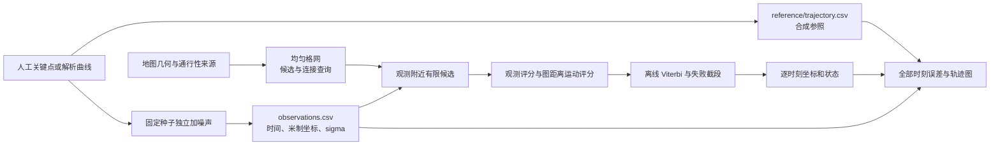

# v0.1 基线技术说明

2026-11-06 将原数据流、地图、定位、接口和评测五份活动说明去重合并为本文。内容描述 2026-11-02 已运行的合成基线，本次整理没有改变算法、输入或实验结果。研究范围见[研究方案](../../研究方案.md)，当前状态与任务见[研究进度与接力说明](../../研究进度与接力说明.md)，新实验的方法要求见[后续实验设计](后续实验设计.md)。运行命令统一在[实验入口](../README.md)。

## 数据流

基线检验的是：在定义清楚的米制平面中，从带噪位置出发，利用障碍假设和运动连续性输出逐时刻坐标，并完整记录改善、退化与断连。它采用二维均匀格网和离线推断，全部轨迹与 GPS 观测均为合成；丰台场景仅提供历史地图几何，不能据此证明真实运动员精度提升或新剖分方法有效。

参照由人工时间—坐标关键点插值或解析曲线产生，不调用定位最短路或 HMM；随后加入独立、各向同性二维高斯噪声。`SeedSequence([seed, scenario_index])` 为每个场景和种子建立 PCG64 随机流，三个固定种子为 20261101—20261103。同一场景只重复噪声，参照路线不变，不能把三个种子当作三条独立路线。

正式运行有七类场景，每类三条、每条 71 个时刻。合成地图一般为 200 × 160 m、格网 4 m，默认每轴噪声为 6 m；丰台样区为 400 × 400 m、格网 8 m。前六类路线持续约 140 s，丰台路线持续 210 s，参照最大速度约 1.14—1.84 m/s，偏向步行尺度。

| 场景 | 已固定的机制与解释边界 |
| --- | --- |
| `obstacle_detour` | 人工路线绕过矩形障碍，观测噪声可能把位置推入障碍 |
| `free_offroad` | 正弦路线合法离路，采样间隔按 1.5、2、2.5 s 循环；装饰道路不要求人贴路 |
| `stop_and_go` | 人工设定 45—85 s 停留，观测仍有噪声 |
| `narrow_passage` | 穿过宽 16 m 的通道，检查剖分与候选覆盖敏感性 |
| `open_low_noise` | 无有用地形边界，噪声为每轴 0.35 m，用于暴露格网量化代价 |
| `wrong_map` | 参照世界为空地，模型地图加入不存在的障碍，保留误纠正与失败 |
| `fengtai_historical` | 历史地图上的解析合成路线；通行性、现实配准及路线现实可走性均未验证 |

场景、路线和噪声在首次模型结果前固定，未按效果调参。标签分别为 `synthetic` 和 `synthetic_on_historical_map`；合成背景中的 `allowed` 是实验设定，不能类推真实地图空白处可通行。噪声尚未覆盖相关偏差、多路径、系统漂移或长缺测，场景集只能支持相应机制检查。

## 接口约定

所有计算坐标采用同一局部米制平面，时间为秒。观测 CSV 列为 `t_s,x_m,y_m,sigma_m`；`sigma_m` 是合成噪声的每轴标准差，不直接等同设备的 accuracy 字段。时间严格递增，允许非等间隔；坐标与时间必须有限，噪声和模型尺度必须为正，候选上限必须为正整数。纯推断函数对空观测返回空序列，非空输入每时刻对应一条输出。

共享类型定义在 [contracts.py](../gpsmap/contracts.py)：

| 类型 | 字段与含义 |
| --- | --- |
| `Observation` | `t_s, x_m, y_m, sigma_m` |
| `Candidate` | `node_id, x_m, y_m, region_id, passability`；候选通行性只有 `allowed` 或 `unknown` |
| `Connection` | `status, distance_m`；状态为 `reachable / unknown / unreachable`，不可达时距离为无穷大 |
| `Estimate` | `t_s, x_m, y_m, region_id, status, candidate_count` |
| `ModelConfig` | `candidate_radius_m=30`、`max_candidates=48`、`max_speed_mps=8`、`motion_sigma_mps=3`；均为基线工程假设 |

地图 JSON 包括 `name, bounds=[xmin,ymin,xmax,ymax], crs, source, background={passability,source}, features`。每个 feature 为 GeoJSON Feature，几何可以是 Polygon、MultiPolygon 或 LineString，属性至少含 `kind, passability, source`。已知 `allowed / blocked` 需要面状几何及依据或明确合成设定；背景只允许 `allowed / unknown`。本版丰台地图全部保留 unknown，不读取服务点个人信息。

地图接口由 [spatial.py](../gpsmap/spatial.py) 实现。`GridMap(spec, cell_size_m)` 保存 `spec` 和候选序列 `nodes`；`candidates(x_m,y_m,radius_m,max_candidates)` 返回候选；`connection(a,b)` 返回图距离与状态；`statistics()` 返回区域、节点、边、未知节点与查询统计；`export_regions(path)` 导出单元几何、中心通行性及相交地物来源。`prepare_map.build_real_sample(gpkg_path, output_dir, cell_size_m=8.0)` 只读 GPKG，返回生成的地图 JSON 路径，并保存区域 GeoJSON、预览及来源记录。

定位接口为 `infer(observations, spatial_map, config) -> (list[Estimate], diagnostics)` 和同签名的 `map_only(...)`。模块本身不读写文件、不导入评测或参照生成代码。CLI 只接收观测、地图、配置与输出路径，并拒绝打开路径中的 `reference` 目录；独立进程测试曾修改及删除参照，预测逐字相同。这用于发现误读答案的实现错误，不是系统级安全隔离。

数据生成接口 `evaluation.generate_suite(output_dir, config, fengtai_spec=None)` 返回数据集目录列表，每个目录包含 `map.json`、`observations.csv`、`reference/trajectory.csv` 和 `metadata.json`。参照 CSV 为 `t_s,x_m,y_m`；metadata 记录场景、种子、合成标签、格网尺度及路线/噪声假设。评价接口 `evaluate_run(dataset_dir,prediction_csv,output_dir,method_name)` 保存逐点误差与指标，`plot_comparison(dataset_dir,predictions,output_path)` 绘制对比图。

定位输出为 `predictions.csv`、`diagnostics.json` 和 `run.json`，分别保存逐时刻估计、诊断、参数与输入哈希及计时。数据生成不写入当前时间，固定条件下可逐字重现；运行及已有结果不覆盖，变更方法或场景时使用新版本和新目录。

## 地图与空间查询

丰台样区由 [prepare_map.py](../gpsmap/prepare_map.py) 读取[已有 GPKG](../../数据核查/2026-11-01/可用地图/丰台基础地图.gpkg)中的道路、植被、水系和政区图层。选区按水系 FID 及面边界 `0/8…7/8` 位置依次考察 400 m 正方形，要求位于政区内，裁后水系、植被面积各至少 1,000 m²，道路长度至少 100 m，取首个满足条件者，不按定位误差选区。实际样区含 7 条道路、1 个植被面、1 个水系面；图层可能重叠，面积不能直接相加当作互斥地表组成。

坐标按源文件 EPSG:4326 标签、`always_xy=True` 转到 UTM 50N（EPSG:32650），减去原点 `(424203,4412963) m`，得到局部 `[0,0,400,400] m`。转换遵循元数据，未由实地控制点验证配准。文件哈希、裁切范围、原始编码和来源保存在[来源记录](../data/maps/fengtai_provenance.json)与[地图 JSON](../data/maps/fengtai_map.json)，另有[区域导出](../data/maps/fengtai_regions.geojson)和[样区预览](../data/maps/fengtai_preview.png)。局部米制 GeoJSON 带 `coordinate_system`，不是普通 WGS84 经纬度 GeoJSON。

水系、植被、道路和背景通行性全部 unknown，类别编码未映射为禁行、跑通性或速度，宽度、坡度与平均车速未进入运动模型。空白表示证据不足。现有字段缺口见[属性核查](../../数据核查/2026-11-01/属性补充核查.md)，不能把历史几何或合成路线当成当前地面可走的证据。

格网从左下角生成，边缘不足一步长的单元裁切后使用实际中心，区域编号为 `r行_c列`。中心被明确障碍覆盖时移除，其他中心保留 allowed 或 unknown；障碍优先，未知不提升为已知通行。单元可以跨越不同地形，导出的 `centre_passability` 只描述中心，`intersects_blocked_geometry` 和 `overlapping_features` 另存相交与来源，不能把中心属性解释成整单元已验证。

候选查询取指定圆内按距离、节点编号稳定排序的最近 K 点。观测在边界上可查询，在地图范围外则返回空，即使搜索圆与地图相交也不自动补点。半径和 K 截断可能排除正确位置，不是无损加速；候选实际覆盖也未必达到整个搜索半径。

中心按八邻接连边，权重是欧氏长度。整条边与明确障碍相交或接触边界时都被排除，防止对角斜切。Dijkstra 查询可跨多个单元；图不连通返回 unreachable，路径任一端点或边经过未知区域即为 unknown，否则为 reachable。即使边两端已知，中间横穿未知窄条也保留 unknown。同长度路径优先不经过未知者，其余按固定顺序选择；这是确定性规则，不是置信度。

最短路按源节点缓存，最多保存 128 组结果。丰台 8 m 格网有 2,500 个候选和 9,702 条无向边，所有节点均未知。统计记录连接查询与 Dijkstra 次数，支持解释耗时，不能仅从一次建图耗时推断性能优势。

一个关键边界案例是：连续空间存在 1 m 通道，但 4 m 格网可能没有中心落入通道，查询因此不可达；该情况已进入地图测试。八邻接也可能高估斜向距离，中心候选带来量化误差。连接接口只输出距离和状态，不返回最短路几何；相邻估计点的绘图直线可能跨障碍，而图上的连接实际绕行，不能据图中直线认定完整路径已被恢复。

## 定位模型

`map_only` 在每个时刻独立选择观测评分最高的候选，不查询运动连接；原始 GPS 对照直接使用原坐标。`infer` 则把观测评分与运动转移组合为 HMM 风格最大路径评分，由 Viterbi 离线解码。三种方法尚不能完全分离量化、地图障碍和运动先验贡献。

对于二维观测 $z_t$、候选 $x_t$ 和每轴标准差 $\sigma_t$，观测评分为

$$\ell_o(x_t,z_t)=-\frac{\|x_t-z_t\|^2}{2\sigma_t^2}-\log(2\pi)-2\log\sigma_t.$$

相邻时刻使用实际间隔 $\Delta t$，地图图距离为 $d_G$。不可达或 $d_G/\Delta t>v_{max}$ 时，转移评分为负无穷；其余为

$$\ell_m(x_{t-1},x_t)=-\frac{1}{2}\left(\frac{d_G}{s_v\Delta t}\right)^2.$$

默认 $v_{max}=8$ m/s、$s_v=3$ m/s，后者对应 `motion_sigma_mps`。它们是全局工程假设，并非实测运动员分布。该随机游走先验偏好较小移动，可能抑制噪声，也可能压缩真实运动、混淆停留与慢行；尚未加入地表速度、坡度或独立方向观测。未知路径允许参与计算只表示证据不足时不硬性排除，不代表现实可走。

动态规划为

$$D_t(j)=\ell_o(j,z_t)+\max_i[D_{t-1}(i)+\ell_m(i,j)].$$

初始候选使用相同先验，以观测评分初始化；每步减去最大分数保持数值稳定，不改变最优路径。候选稳定排序，平分时选排序靠前者；整段结束后回溯，未来观测可以改变过去位置，因此不是实时滤波。转移势未按后继集合归一化，候选集合外也未建隐藏状态，累计分数不是规范化概率或可靠置信度；诊断明确保存 `transition_normalized=false`、`score_is_calibrated_probability=false`。候选上限 K 时，评分约需 $O(TK^2)$ 次检查，回溯内存为 $O(TK)$，另有地图查询成本。

| 输出状态 | 行为与解释 |
| --- | --- |
| `ok` | 通过当前候选与连接约定，不表示位置正确 |
| `map_unknown` | 选中候选或连接涉及未知通行性，不表示数值推断失败 |
| `no_candidates` | 保留该时刻原始 GPS，结束前段，不视为成功纠正 |
| `reset_unreachable` | 当前候选均无法从前一时刻转移，先回溯前段，再从当前观测重启；不证明存在跨段可行运动 |

状态只表达主要情况，重启优先于未知；`unknown_path_indices` 仍记录涉及未知的输出下标。诊断还保存无候选、重启下标、片段数、候选数量、连接查询、速度拒绝和不可达拒绝计数。失败点和没有失败标记但误差更大的点都需要保留，不能只评估 `ok`。

## 评价与验证边界

评价代码见 [evaluation.py](../gpsmap/evaluation.py)，首先核对参照与预测的时间逐点对齐，拒绝缺行、重复或倒序时间和非有限值。在同一局部米制坐标下，逐点误差为 $e_i=\|\hat x_i-x_i^{ref}\|_2$，所有时刻等权，不是按时间间隔加权积分。

| 指标或字段 | 定义 |
| --- | --- |
| `n` | 全部对齐观测点数，含回退和重启 |
| `rmse_m` | $\sqrt{\sum_i e_i^2/n}$ |
| `mean_m` | $\sum_i e_i/n$ |
| `median_m` | 排序误差的中位数；偶数样本取中间两值平均 |
| `p95_m` | NumPy 的线性插值 95 分位数：在排序误差的零基下标 $h=0.95(n-1)$ 处对相邻值插值 |
| `max_m` | 最大逐点误差 |
| `status_counts` | 各输出状态出现次数 |
| `failure_count` | `no_candidates` 与 `reset_unreachable` 次数之和 |
| `map_unknown_count` | 主状态为 `map_unknown` 的点数；重启时兼有未知的信息另外查看诊断下标 |

输出 `{method}_errors.csv` 包含参照、估计坐标、误差和状态，`{method}_metrics.json` 保存上述统计与聚合口径。原始 GPS 不预先平滑或筛选；无候选、重启和退化都进入误差分母。`ok` 不保证准确，unknown 也不能直接当作已证实的障碍或通行空间。

[报告代码](../gpsmap/report.py)中的场景汇总 RMSE 为 $\sqrt{\sum_r n_r RMSE_r^2/\sum_r n_r}$；表中 P95 是各运行 P95 的算术平均，不是合并样本 P95。地图构建、纯推断和评价分别计时，报告中的建图与推断时间为各运行的平均墙钟时间；绘图不冒充定位延迟。当前是单机样例计时，不能据此作严格性能基准结论。

图中左侧叠加参照、原始 GPS、估计及失败点，右侧显示全部时刻误差。无候选点的前后与重启点的前一段断线，失败坐标仍以红叉显示。普通估计点连线只是采样点间的弦，完整行进路径不能从这条折线推断。图上注明 SYNTHETIC，未知历史地物以浅色或纹理表达，米制坐标与秒时间明确标记；英文图例用于避免字体缺字。

2026-11-02 的模块和集成核查合计 33 项通过，覆盖地图未知传播与窄通道边界、独立穷举核对 Viterbi、未来信息作用、非等间隔采样、失败处理、手算误差、参照隔离与输出不覆盖。测试证明当时的实现与契约一致，不证明定位精度或创新成立。两套完整运行的 84 份输入及 42 份预测逐字一致，63 行指标独立复算一致；本次文档合并未重跑算法测试。

原始证据见[运行记录](运行记录_2026-11-02.md)、[正式结果](../runs/2026-11-02-v0.1-verified/results/实验结果.md)、[最终复现记录](../verification/final-reproducibility.json)与[版本记录](../版本记录.md)。早期 `results/first-track/` 和 `data/smoke/free_offroad` 保留联调历史，含修复前的装饰线表示，不作为正式验收入口。低噪声和错误地图已有退化，丰台全 unknown 的改善不能归因于已验证地物知识；现有证据也不支撑真实精度、完整连续路径、校准置信度或其他剖分优越性。
