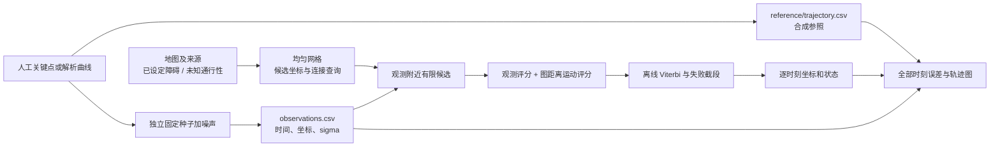

# 第一版实验定义与完整数据流

本版回答的最小问题是：在一个定义清楚的米制平面中，能否从带噪坐标出发，利用明确的障碍假设与运动连续性，输出可以逐时刻核对的坐标，并完整记录改善、退化与无法连接的情况。它不检验真实运动员定位精度，也不证明剖分方法的新颖性。

第一条路线在 200 × 160 m 的合成地图上绕过一个矩形障碍，使用人工定义的时间—坐标关键点插值成 71 个时刻。6 m 每轴高斯噪声生成 GPS 观测，4 m 网格提供候选。后续所有场景固定采用相同模型参数；低噪声开阔地按预设使用 0.35 m 噪声，专门检查量化代价。三个种子重复的是噪声，不是三条独立路线，不能把它们当作路线多样性或显著性证据。

参照只进入最后的评价。定位是单独的命令进程，它接收观测、地图、参数和输出路径；模块本身没有文件 I/O，命令入口还会拒绝打开路径中的 `reference` 目录。独立进程测试把参照改成无效文字、随后删除，三次预测逐字相同。该保护用于发现误读答案的实现错误，不是系统级安全隔离。

候选搜索半径 30 m、最多 48 个点，按照到 GPS 的距离和节点编号稳定排序。因此数量上限可能使实际候选覆盖小于 30 m，不能把“在半径内”误解为所有点都进入推断。格网中心是候选坐标，格网单元不是一个任意精确的坐标估计。图采用八邻接，连续空间中可通过的极窄通道可能在网格中消失。

模型先给每个候选计算二维高斯观测分数，再查看前一时刻的候选能否通过图连接到这里。图距离除以实际时间差若超过 8 m/s，就拒绝该转移；其余按 3 m/s 尺度的二次移动代价打分。Viterbi 为每个候选保存最佳前驱，整段结束后回溯。观测时间不必等间隔，也允许一次跨越多个区域。这些参数是机制原型假设，没有由运动员数据估计；现有参照最大速度约 1.14—1.84 m/s，偏向步行尺度。

当地图上找不到候选，程序保留该时刻原始 GPS，并记录失败；如果所有连接都不成立，则在当前时刻重新开始一段。两类情况都进入误差统计。输出的采样坐标用线连接只用于查看轨迹形状，不是相邻时刻间恢复出的完整行走路径；图连接查询当前只提供距离，不提供整条路径几何。绘图在回退和重启处断开相关线段。

丰台样区为 400 × 400 m，原始坐标按 WGS84 元数据投影到 UTM 50N，减去保存的局部原点后用米运算。地图中的 7 条道路、1 个植被面、1 个水系面和背景都保留 unknown。该场景检验真实地图文件能否接入流程；数值改善主要来自格网与运动先验，不能归因于已经得到验证的地物通行约束。未知区域允许参与计算，只表示证据不足时不硬性排除，不表示现实可通行。

三种对照分别为原始 GPS、仅选择最近地图候选、地图与运动评分共同解码。这个对照能看出加入时序评分的变化，但尚未把量化、地图障碍和运动先验的贡献完全拆开。下一轮应增加相同候选预算下的无障碍运动对照，再比较不同分辨率/剖分，避免把简单平滑收益归因于地图创新。
