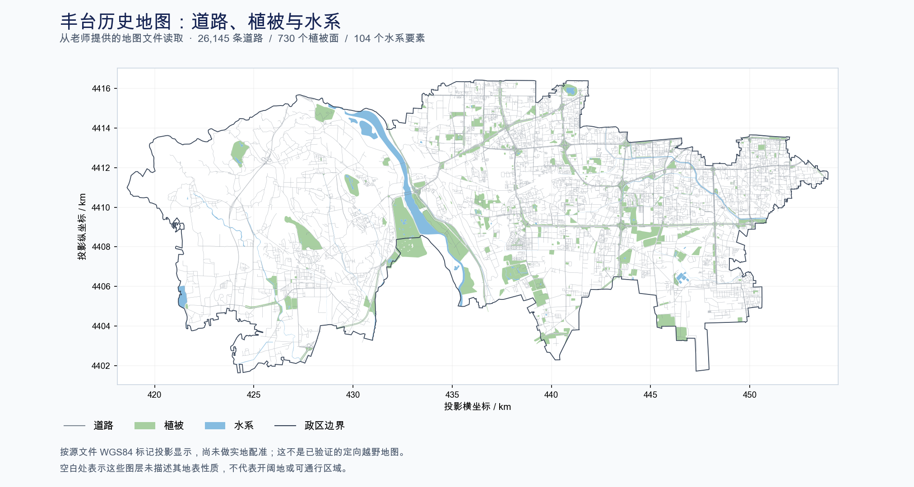

# 老师提供资料的可用性评估

核查日期：2026年11月1日。对象为毕设目录下的 `eNavaStar.zip` 和 `丰台数据.rar`。原压缩包保留不变，解包、统计、转换和预览均在本目录内完成。

## 对论文最直接的结论

有用。现在已经有一份可以实际读取的二维矢量地图，足以开始地图整理、区域剖分和候选点生成的原型实验，数据准备可以从“寻找任何可用地图”推进到“筛选小区域并补齐语义”。但现有资料还不足以完成真实定向越野的定位精度实验：未发现带时间戳的运动员GPS轨迹，也未发现独立高精度位置参照；地图中的植被分类也不足以直接表达跑通性。

这份资料适合支撑老师所说的“区域剖分建立”的前期实现。对“结合运动特征剖分”和“定位纠正”的验证，还需要相应的运动观测、通行性标注和位置参照。资料采用二维表示，并不能单凭这一点推断导师已经正式确定论文只做二维。

## 地图实际包含什么

丰台压缩包解包后有150个文件、31套TAB图层。按每套TAB、DAT、MAP、ID、IND组合进行完整文件哈希比较，有21种不同的文件组合；重复版本不能当成独立样本。全部31套均成功读取。

最有用的是内部“丰台数据/丰台数据”目录下的六个图层：

| 图层 | 实际读取的要素数 | 几何 | 当前用途 |
| --- | ---: | --- | --- |
| 丰台政区 | 1 | 多边形 | 限定实验区域范围 |
| 道路 | 26,145 | 线串 | 道路候选点、连通关系及道路匹配基线的原始材料 |
| 植被 | 730 | 多边形 | 提供面边界，尝试基于地物边界的剖分 |
| 水系 | 104 | 97个多边形、7个多多边形 | 提供水域边界；是否不可穿越需要进一步确认 |
| 铁路 | 58 | 线串 | 作为地物参考；不能把每条线都自动当作绝对障碍 |
| 服务点 | 27,000 | 点 | 可作地标线索，本轮未将地址、电话等明细写入报告或导出副本 |

道路属性文件头有26,147条物理记录，其中2条标记删除，因此实际有效要素为26,145条。六个图层均无空几何，单要素几何合法性检查全部通过，也均无Z坐标。这不等于已经通过道路连通性、地物完整性、现实一致性或定位精度检验。

这六个图层的文件坐标标记均被GIS读取器识别为WGS84（EPSG:4326），政区范围约为东经116.048656—116.461607、北纬39.761334—39.895515。尚未通过控制点验证坐标标签是否与真实位置一致，不能仅凭标签就直接与新采集GPS进行精度比较。算法中的距离、面积和分辨率应使用适当的米制坐标；本次预览按该标签转换到UTM 50N，仅用于显示。

地图格式为MapInfo TAB；一套地图通常由TAB、DAT、MAP、ID等文件共同组成，不能只保留一个TAB文件。[GDAL格式说明](https://gdal.org/en/stable/drivers/vector/mitab.html)

## 语义属性的真实可用程度

植被730条记录的编码全部为 `220200`。它能提供植被面边界，却没有在这个编码字段里区分草地、稀疏林、密林或不同跑通性。植被名称中661条还是字面字符串 `NULL`。不能把地图上的所有绿色区域统一认定为同一种运动速度，也不能把图层没有覆盖的白色区域认定为可通行开阔地。

道路有类别、宽度和起终节点号等属性。宽度只有3.5、5.5、13、15四档，具体单位、测量来源以及是否按道路类别默认赋值需要确认，不能直接当作实测精确宽度。最大纵坡全部为 `-999999.9`，平均车速全部为 `-32767`，它们是疑似缺失占位值，不是可以用于模型的有效观测；即使有真实车速，也不能直接替代运动员速度。通行月份全为 `111111111111`，仍需要字段说明。

水系有四种编码，但没有随包发现解释这些编码的字典。水面、沟渠、可涉水区域、桥梁和其他跨越方式应分别处理；当前不能依据“水系”二字对所有相交运动一律设为不可能。

上述主要属性统计同时通过GIS读取器与独立的固定记录解析核对，记录数、植被编码、道路宽度分布及缺失占位值一致。完整说明见[属性补充核查](属性补充核查.md)及[图层核查统计](图层核查.json)。

## 需要剔除或单独处理的内容

压缩包中还有自来水、消防水、煤气、电力、通信等图层，以及另一份重复目录。这些图层使用本地非地球坐标，单位标记为米，范围大致在X=507000、Y=309000附近；与丰台六个图层的经纬度不是同一坐标表示。缺少定位说明或控制点时，不能直接叠加，也不能根据管线位置推断地面通行障碍。

本地“基础层”与“辅助层”的两个重复版本分别包含6个、1个不合法几何，暂不纳入主要实验数据。两份“无标题”表为空。其他图层虽然可读取，也不因此自动具有论文所需的语义。

丰台六个属性文件的头部更新日期标记为2015年1月12日，部分管线表为2005—2006年。这里只能记录文件元数据，不能当作测绘或采集日期；地图是否反映现在的场地仍须核实。未发现地形高程模型、等高线图层、轨迹记录或位置参照文件。

`eNavaStar.zip` 主要是Windows CE ARM/MFC时期的二维地图绘图框架，可参考点线面、图层、地图块和跨块关系的组织方式。可见源码的关键读取、绘制函数尚未完成，未发现HMM、Viterbi、GPS轨迹处理或运动特征剖分实现；其自定义块格式也不能直接视为已支持这份TAB地图。因此当前优先使用独立GIS工具处理地图。详情及内嵌RAR正文未成功解包的检查范围见[源码核查](eNavaStar源码核查.md)。

## 已经准备好的可复用结果

已将政区、道路、植被、水系、铁路五个图层整理为[丰台基础地图.gpkg](可用地图/丰台基础地图.gpkg)，共27,038个要素。它是单文件地图副本，保留原几何、字段、属性值和坐标标记；未自动修复几何、改写缺失值或补造通行性。导出后重新读取，五个图层的记录数、字段名、属性值和几何坐标均与输入逐项核验一致，见[转换核验](可用地图/转换核验.json)。

另外保留了[压缩包记录](压缩包记录.json)、[文件清单](丰台文件清单.json)、地图预览和检查脚本。后续可以直接从此副本选择小范围进行处理，不需要先恢复旧应用。

## 下一步怎样使用

建议先选一块同时包含道路、植被和水域边界的小区域，检查是否存在遗漏地物和明显错误，再比较均匀网格与保留地物边界的剖分。初期可以使用明确标为合成的轨迹及噪声，检验程序和约束是否合理；这一阶段只能支撑机制实验，不能宣称已经提高了真实运动员的定位精度。

与此同时，最值得向李老师确认的是：这份地图的来源、测绘年代、比例尺或精度、真实坐标系及编码字典；它是历史工程示例还是拟用于本论文的场地；是否还有对应的定向图、GPS轨迹、采集设备信息和RTK/控制点等参照。如果没有现成轨迹，再根据能取得语义地图且便于到达的小场地安排采集，暂时不必因为文件名是“丰台”就去丰台采数据。

当前数据状态可概括为：已有可读取的二维地图，通行性语义需要补充，真实运动轨迹和独立位置参照仍待落实。
