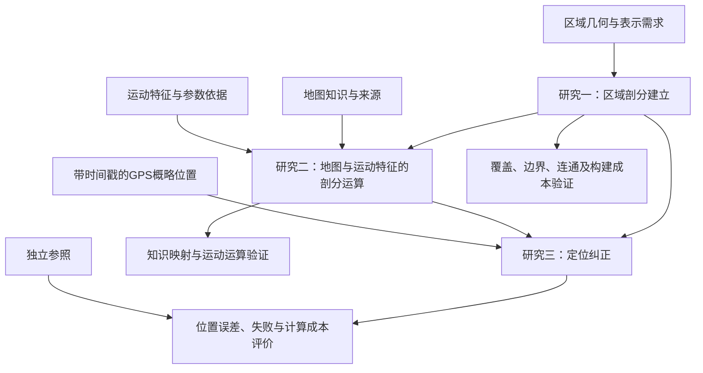

# 定向越野区域剖分、剖分运算与定位纠正研究方案

2026年11月5日开始整理，11月6日完成本轮对齐。依据为用户提供的李老师会后文字总结及同次讨论的录音转写；实际会议日期未提供。本文统一定义研究内容、边界与验收要求，具体进展在[研究进度与接力说明](研究进度与接力说明.md)更新。本文是对导师意见的项目落实，不代表具体方法已通过查新、实验或学校审核。

## 依据与研究定位

李老师会后总结原文为：

> 1，定向越野区域剖分建立，要考虑面状、体状各自的用处，以及论文里面的实际处理；
> 2，基于定向越野地图以及定向越野运动员运动特征的剖分运算；
> 3，基于剖分覆盖（已经集成定向图知识）的定位纠正。

录音补充了三点的依赖关系：先建立覆盖研究区域的计算空间，再把定向图知识与运动特征转成可运算的信息，最后结合概略位置推断运动员位置。老师要求尽快把主线和前置条件落实为文字，控制研究范围。定位定姿、惯导或组合定位可以提供前置位置；当前主要输入按GPS考虑。轨迹预测是做到第三项以后的可选扩展。

转写中的“定位定资”“抛分”“HM”分别按定位定姿、剖分、HMM理解；“概率位置”在多处按语境理解为“概略位置”。这不意味着输入必须是完整概率分布。低空、兵棋和全球遥感剖分是录音提出的查阅线索；关于高度标准、网格优劣等口头说法不直接作为论文事实。三角形或六边形并未最终选定，老师认可研究潜力也不等于三个创新点已经成立。

本研究拟以GPS提供的有误差位置为输入，构建适用于定向越野的空间剖分，研究地图知识与运动员运动特征在剖分上的表达和运算，再利用知识化剖分覆盖开展定位纠正，并分别验证空间表示、知识运算和定位结果。正式论文题名仍可据最终方法和学校要求调整，研究主线按上述三项推进。

## 研究一：定向越野区域剖分建立

这一部分回答“研究区域怎样变成适合计算的空间单元”。输入是具有明确坐标、范围和来源的区域几何，以及任务需要保留的地形结构；输出是单元几何、编号、边界和邻接等空间关系，以及生成方法和适用边界。

面状与体状各自适用于什么问题、本文采用哪种处理，已经是必需的论证内容。应从运动发生的空间、所需表达的高程或垂向关系、现有数据和计算代价说明选择；若简化，要说明保留与舍弃的信息。是否真正实现体剖分、是否采用带高程属性的面状表示，留待这一论证决定，不把“有高程”直接等同于“已经做了体剖分”。

现有均匀四边形格网可作为基础。三角形、六边形、边界保持及自适应方案进入候选比较，先根据文献和样例筛选，不预定某一形状更优，也不要求无目的地实现所有方案。录音提出的快速或动态生成可以转化为候选问题；若选择动态生成，必须定义触发条件、更新范围和代价，不能仅因提到“动态”就强制逐时刻重剖分。

本部分至少形成一份表示选择论证、可检查的剖分定义与样例，以及覆盖、边界和连通关系的验证。比较方法时记录单元和连接规模、构建成本、几何近似损失，随后再分析这些因素对定位的影响。具体容差与接受标准应在试验前根据尺度确定。定位误差改善不能代替剖分正确性的检查。

## 研究二：基于地图与运动员运动特征的剖分运算

这一部分回答“地图知识和运动特征怎样成为剖分上的计算依据”。输入包括研究一的空间单元、具有来源和不确定性说明的地图要素，以及待校准的运动特征；输出是可查询、可组合的单元属性、单元间关系及运动相关运算结果。

需要首先定义地图对象与剖分之间的对应方式。一个单元跨越多个地形时，怎样保留其组成、边界和局部通行条件；地图类别、物理障碍、规则禁入、通行困难和未知属性如何区分；地图要素的覆盖、相交或缺失如何影响表达，均应有明确语义。是否使用主导类别、面积占比、局部边界或其他表示，属于候选方法，不能在没有验证时指定为最终方案。

运动员的行进速度、路线选择及其与地形的关系，应参与这套计算。例如，可以研究单元间可达性、给定时间的可行移动范围或移动代价；具体采用哪些运算、参数从何而来、适用什么运动状态，需要逐项定义。地图规范和文献案例参数不能自动当作个体运动员的实测速度；从同一GPS派生的速度或方向也不能未经论证作为独立、准确观测。

第二项包含知识映射与运动相关运算，不能仅做属性导出，也不能全部压缩成HMM的一项评分。它与第三项按研究职责区分，不机械规定第二项全部离线执行。当前运动状态可能动态进入查询；若运动特征进一步改变剖分尺寸、边界或连接，需要说明它与研究一的关系并安排独立对照。

本部分至少交付带来源的数据字典、地图到剖分的映射规则、运动相关运算的输入输出定义，以及可人工核验的样例。验证混合地形、边界、未知信息及单元间移动的处理；运动参数若缺真实校准，只能标记为合成假设。若评价路径长度、时间或运动代价，必须明确单位与含义，避免将无量纲成本当作米或秒。

## 研究三：基于知识化剖分覆盖的定位纠正

这一部分回答“怎样利用上述计算依据与有误差的位置观测进行估计”。输入为带时间戳的GPS概略位置、观测质量信息，以及研究一、二提供的空间表示和运算；输出目标是观测时刻的位置估计、相关区域与失败标记。最终算法若只输出区域或路线，应据此收窄定位精度主张。

需要明确候选位置如何产生，观测与运动信息怎样参与推断，怎样处理地图错误、未知地形、缺测、无候选及不合理连接，并说明坐标输出与离散单元的关系。HMM是已有学习和实现基础上的候选框架，算法名称本身不构成创新；选择其他方法也应服务于同一任务。

v0.1采用整段离线推断，未来观测可以影响过去估计，这是当前基线的处理方式。最终在线还是离线、延迟要求与可用观测范围，仍需明确；不能直接把已有程序的限制当成论文已定范围。若输出置信度，需要单独说明其概率含义和校准依据。

本部分至少交付可复现的纠正方法、合理基线与贡献分解、独立路线上的评价和失败分析。需要区分格网量化、地图信息和运动先验的影响，补齐相近候选或计算预算下的无地图运动对照；比较剖分时尽量固定地图信息、推断条件和调参数据，并报告实际成本。真实精度必须使用质量明确的独立参照；平滑、贴图或区域识别不能自动替代坐标精度证据。

## 三项怎样共同组成方法

三项可以迭代和并行：先固定共同小样例和接口，再分别完善表示、运算与推断。当前原型的“地图／定位／评测”是工程模块划分，不等于论文研究内容划分；同一研究内容可能跨模块实现。保持同一坐标、时间单位和运动参数解释，避免把同一通行或运动惩罚在多个模块重复计入。

已有接口和源码作为基线复用，新研究需要修改接口时应明确版本及迁移方式。基线中某种属性无法表达或尚未使用，应作为缺口记录，不能通过重新命名就视为完成第二项。

## 数据与证据

数据工作分为地图知识、带时间戳的位置观测和独立参照三类。当前丰台地图提供几何基础，但跑通性、坡度、实际配准及现势性仍不充分；这些缺口影响方法的实地适用性。可以使用明确标记的合成语义小地图验证前两项，不需要等待完整实测GPS或高精度参照后才开始剖分研究。

实测前先落实地图来源、坐标和语义条件，再进行小规模试采，记录设备、时间戳、采样间隔、原始精度字段、关键点到达时间、环境情况和同步方式。参照方案必须同时考虑：经过质量检查的高精度定位或测量资料可用于相应精度评价；检查点只支撑对应时刻或点位，区域标签只支撑区域评价；另一部普通手机未经验证不能作为真值。

调参与最终测试使用独立路线或采集批次。已知合成轨迹可用于机制验证，但不应全部由定位算法使用的同一最短路代价生成。未知地形保持未知，假设与观测分开保存，参照只进入评价。具体实验矩阵见[后续实验设计](实验原型/docs/后续实验设计.md)。

## 已明确边界与待定选择

当前主线按导师三项落实，定位定姿及组合导航作为前置或辅助内容；AR、虚实显示和完整旧系统恢复不列为本轮研究工作包，轨迹预测属于可选扩展。原开题报告与最终题名、提交材料如需同步调整，按学校和导师流程落实，不以行政调整尚未完成为由重新悬置已明确的研究主线。

仍需通过论证或后续沟通确定：面状／体状的具体实现程度，剖分形状和尺度，地图知识与运动特征的表达方法，推断模型及在线／离线要求，实测场地与参照，以及学校硬截止。候选方法变化属于三项内的方案选择；如改变三项主线，应记录新的明确依据。

三个研究内容分别可以形成方法贡献，但贡献是否新颖、有效，需要文献比较和实验支撑。自适应分辨率只是候选假设之一，不把“换网格”“增加属性”“采用HMM”预先等同于创新。

## 推进与写作

方法迭代以同一张小地图下的三项定义为共同基础：区域剖分选择与几何期望、地图和运动规则的输入输出、定位观测和评价条件。随后进行剖分及知识运算的小规模验证，并行补齐既有定位基线的对照。再根据结果筛选方案、补实测条件、开展独立评价，持续积累方法文字、图表和失败分析。

论文正文可以分别设置区域剖分、剖分运算、定位纠正的方法内容，再用统一实验说明三者如何配合；具体章节安排服从学校格式。先记录研究选择及证据，再形成结论。项目不沿用此前未重新估算的工时和周数作为承诺，当前具体任务和完成状态只在进度文件维护。
